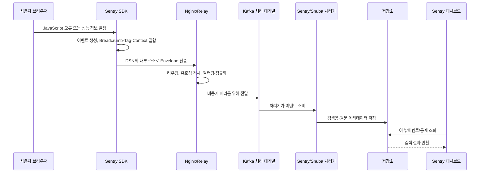

# Phase 1: Sentry 기본 개념

## 이 문서에서 답하는 질문

- Sentry는 무엇이며 어떤 문제를 해결하는가?
- 브라우저 오류는 어떤 경로로 Sentry에 도착하는가?
- SDK, DSN, Sentry 서버, 대시보드는 어떤 관계인가?
- Message, Exception, Breadcrumb, Tag, Context, Transaction, Span은 어떻게 다른가?
- Sentry SaaS와 Self-hosted 중 무엇이 달라지는가?

이 문서는 개념을 먼저 이해하기 위한 설명입니다. 실제 SDK 데이터와 화면 지원 여부는 Phase 4~7에서 설치된 버전을 대상으로 검증합니다.

## Sentry란 무엇인가

Sentry는 사용자의 브라우저나 애플리케이션에서 발생한 **오류와 성능 정보를 모아 원인 분석을 돕는 관측 도구**입니다.

프론트엔드 개발 중에는 개발자 도구 콘솔로 오류를 볼 수 있지만, 운영 환경의 사용자가 겪은 오류는 개발자 컴퓨터에서 바로 보이지 않습니다. Sentry는 다음 질문에 답할 자료를 한곳에 모읍니다.

- 어떤 오류가 발생했는가?
- 어느 파일의 어느 코드에서 시작됐는가?
- 오류 직전에 사용자가 어떤 화면과 API를 거쳤는가?
- 어떤 브라우저, 배포 버전, 업무 채널에서 많이 발생하는가?
- 같은 원인의 오류가 몇 번 발생했고 몇 명에게 영향을 주었는가?
- 어떤 화면이나 API가 느린가?

Sentry는 모든 로그와 업무 데이터를 무조건 저장하는 데이터 웨어하우스가 아닙니다. 오류·성능 진단에 필요한 신호를 수집하는 도구이며, 개인정보나 거래 원문을 넣지 않도록 별도 정책이 반드시 필요합니다.

## 가장 중요한 네 구성요소

| 구성요소      | 쉬운 설명                                    | 이 PoC에서의 위치                   |
| --------- | ---------------------------------------- | ----------------------------- |
| SDK       | 앱 안에서 오류와 성능 정보를 감지하고  전송하는 라이브러리     | React 테스트 앱의 `@sentry/react`  |
| DSN       | SDK가 어느 Sentry 프로젝트로 보낼지  알려주는 접수 주소  | 테스트 앱의 환경 변수                  |
| Sentry 서버 | 이벤트를 받고, 처리하고, 저장하고,  검색하는 여러 서비스의 묶음 | Docker Desktop 안의 컨테이너들       |
| 대시보드      | 사람이 이슈, 이벤트, 성능, 통계를  조회하는 웹 화면       | 브라우저의 `http://localhost:9000` |

### DSN은 비밀번호인가

브라우저 SDK용 DSN은 프론트엔드 코드에서 사용되므로 
일반적인 서버 비밀번호처럼 숨길 수 있는 값은 아닙니다. 
DSN에는 이벤트를 특정 프로젝트로 라우팅하는 공개 키와 서버 주소가 들어가며, 
Sentry 관리자 권한을 주지는 않습니다.

그렇다고 아무 곳에나 배포해도 된다는 뜻은 아닙니다. 
노출된 DSN으로 가짜 이벤트가 유입될 수 있으므로 허용 도메인, 속도 제한, 
인바운드 필터를 함께 사용해야 합니다. 
이 프로젝트의 작업 규칙에 따라 실제 DSN은 Git에 커밋하지 않고 `.env`에만 두며 
`.env.example`에는 자리표시자만 둡니다.

## 브라우저 오류가 저장되기까지

위 그림은 이해를 돕기 위해 세부 소비자를 묶어 표현한 것입니다. 
실제 Self-hosted 26.8.0에는 이벤트 종류별 소비자와 저장 경로가 더 많습니다.

### 단계별 설명

1. **오류 감지**  
   SDK가 처리되지 않은 JavaScript 오류, 명시적으로 보낸 예외나 메시지, 
   네트워크 Breadcrumb 등을 수집합니다.
2. **이벤트 구성**  
   Stack trace, 현재 URL, 브라우저 정보, Release, Environment, Tag, Context, Breadcrumb처럼 
   설정된 자료를 하나의 전송 단위로 묶습니다. Sentry에서는 여러 데이터 항목을 묶는 전송 형식을 **Envelope(봉투)** 라고 부릅니다.
3. **DSN으로 전송**  
   브라우저는 인터넷의 Sentry SaaS가 아니라 DSN에 적힌 주소로 전송합니다. 
   이 PoC에서는 `localhost`, 회사 폐쇄망에서는 내부 Sentry 도메인이 됩니다.
4. **수신과 검사**  
   Nginx가 접수 요청을 Relay로 보내고, 
   Relay가 Sentry Web에서 얻은 프로젝트 설정에 따라 데이터 형식, 필터, 할당량, 정규화 등을 처리합니다. Self-hosted의 Relay는 processing mode로 동작하므로 처리된 이벤트를 Kafka에 넣습니다.
5. **대기열과 비동기 처리**  
   Kafka가 작업을 잠시 쌓아 두고 소비자들이 순서대로 처리합니다. 
   접수 순간에 모든 계산을 끝내지 않아도 되어 갑작스러운 이벤트 증가를 흡수할 수 있습니다.
6. **저장과 그룹화**  
   처리 결과가 목적에 따라 ClickHouse, PostgreSQL, SeaweedFS 같은 저장소로 갑니다. 
   비슷한 오류 이벤트는 하나의 Issue로 그룹화될 수 있습니다.
7. **조회**  
   개발자는 대시보드에서 Issue, 개별 Event, Trace, 통계와 검색 결과를 봅니다.

### 인터넷이 끊겨도 수집할 수 있는 이유
브라우저와 Sentry 서버가 같은 내부망에서 서로 통신할 수 있고 필요한 서비스가 모두 내부에 있으면, 
SDK 이벤트 수집의 핵심 경로는 외부 인터넷을 거칠 필요가 없습니다.

다만 다음 두 조건은 구분해야 합니다.
- **내부 통신 성공**: 브라우저 → 내부 Sentry, Sentry 컨테이너 상호 간 통신
- **외부 통신 차단**: 이미지 저장소, npm, Sentry CDN, SaaS 연동, 공개 API 접근 실패
설치 때 필요한 파일을 미리 반입하지 않았거나 SDK를 외부 CDN에서 불러오면 인터넷 차단 후 실패합니다. Phase 8에서 두 경로를 실제로 분리해 검증합니다.

## Event와 Issue의 차이

- **Event(이벤트)**: 특정 시각에 한 번 발생한 개별 기록입니다. 같은 오류가 100번 발생하면 이벤트는 100개일 수 있습니다.
- **Issue(이슈)**: Sentry가 비슷한 원인이라고 판단한 이벤트를 묶은 작업 단위입니다. 담당자 지정, 해결 처리, 첫 발생과 최근 발생 추적은 주로 Issue 기준입니다.

그룹화는 오류 종류, 메시지, Stack trace 등의 정보를 이용합니다. 
메시지에 매번 바뀌는 거래번호를 넣으면 같은 원인의 오류가 여러 Issue로 갈라질 수 있으므로 
동적 업무값은 메시지보다 Tag나 Context에 두는 편이 안전합니다.

## 수집 데이터 개념 비교

| 개념          | 무엇인가                              | 적합한 예                             | 검색·집계 관점                            |
| ----------- | --------------------------------- | --------------------------------- | ----------------------------------- |
| Exception   | 예외 객체와 Stack trace를 포함한 실패        | `TypeError`, API 처리 중 던진 `Error`  | 오류 원인과 코드 위치 분석의 중심                 |
| Message     | 예외 객체 없이 직접 남기는 의미 있는 사건          | `recipient validation failed`     | 제목/레벨 중심 사건에 적합                     |
| Breadcrumb  | 오류 전에 있었던 작은 행동의 시간순 흔적           | 화면 진입, 버튼 클릭, API 400 응답          | 상세 화면에서 흐름 분석; 일반 집계 축으로는 부적합       |
| Tag         | 짧고 반복 가능한 검색·분류 값                 | `channel:hana-ez`, `currency:KRW` | 검색, 필터, 그룹별 집계에 적합                  |
| Context     | 구조가 있는 상세 진단 정보                   | 재시도 횟수, 정제된 업무 상태                 | 상세 분석용; Tag처럼 안정적인 집계 축이라고 가정하면 안 됨 |
| Transaction | 한 사용자 작업이나 페이지 로드의 상위 성능 단위       | 송금 화면 로드, 송금 제출                   | 전체 소요시간과 관련 Span을 묶음                |
| Span        | Transaction/Trace 안의 개별 작업 구간     | `fetch /recipient/validate`, 렌더링  | 느린 세부 구간 분석                         |
| Trace       | 여러 Transaction과 Span을 잇는 전체 호출 흐름 | 브라우저 → API → 백엔드 처리               | 서비스 간 인과관계 분석                       |

### Message와 Exception
`captureException(error)`는 오류 객체와 Stack trace가 있어 “어디서 왜 실패했는가”를 분석할 때 적합합니다. `captureMessage(message)`는 예외가 없어도 기록해야 하는 업무상 사건에 적합합니다. 단순 업무 거절이나 예상된 검증 실패까지 모두 Exception으로 만들면 실제 코드 결함과 섞여 경보 품질이 떨어질 수 있습니다.

### Breadcrumb와 일반 로그
Breadcrumb는 이벤트 하나에 딸린 “직전 행적”입니다. 독립적인 전체 로그 저장소가 아닙니다. 오류가 전송될 때 당시 SDK 버퍼에 있던 Breadcrumb들이 함께 붙습니다. 따라서 모든 사용자 행동을 영구 감사 로그로 남기는 용도로 사용하면 안 됩니다.

### Transaction과 Span
Transaction은 큰 작업, Span은 그 안의 작은 구간이라고 이해하면 됩니다. 최근 Sentry 데이터 모델과 화면에서는 Transaction도 Span 중심으로 표현될 수 있으므로, Phase 4와 Phase 6에서는 설치된 26.8.0 UI가 실제로 보여 주는 명칭을 기준으로 기록합니다.

## Source map이 필요한 이유
운영용 JavaScript는 보통 압축되고 파일명이 변합니다. 
이 상태의 Stack trace는 `app-a1b2.js:1:8342`처럼 사람이 읽기 어렵습니다.

**Source map(소스 맵)** 은 압축된 위치를 원래 TypeScript/React 소스 위치로 되돌리는 지도입니다. 
SDK가 자동으로 원본 코드를 보내는 것이 아니라, 
빌드와 일치하는 Source map을 Sentry에 별도로 업로드해야 합니다. 
Release 값이 앱 빌드와 업로드 산출물 사이에서 정확히 일치해야 합니다.

## SaaS와 Self-hosted 비교

| 관점       | Sentry SaaS           | Self-hosted Sentry        |
| -------- | --------------------- | ------------------------- |
| 운영 주체    | Sentry가 플랫폼 운영        | 회사 또는 PoC 사용자가 운영         |
| 데이터 위치   | Sentry가 제공하는 클라우드 환경  | 직접 준비한 서버와 저장소            |
| 설치·업데이트  | 서비스에서 관리              | 이미지 반입, 마이그레이션, 백업을 직접 관리 |
| 확장·고가용성  | 서비스가 관리               | 직접 설계해야 함                 |
| 인터넷 의존   | SaaS 접속 필요            | 핵심 수집 경로를 내부망에 둘 수 있음     |
| 기능 제공 시점 | 새 기능이 먼저 제공될 수 있음     | GA 기능 중심이며 구성·버전에 따라 차이   |
| 외부 연동    | 관리형 연동을 사용하기 쉬움       | 폐쇄망 정책과 네트워크 허용이 필요       |
| 비용 형태    | 사용량/플랜 비용             | 서버·스토리지·운영 인력 비용          |
| 장애 책임    | 서비스 경계에 따라 Sentry와 분담 | 대부분 자체 운영 조직 책임           |

Self-hosted를 선택하면 라이선스 비용만 비교해서는 안 됩니다. 
버전 업데이트, 보안 패치, 디스크 증설, 백업, 장애 복구, 외부 연동 관리까지 운영 비용에 포함됩니다.

공식 Self-hosted 배포는 간단한 사용 사례, 낮은 이벤트 양, PoC를 위한 단일 노드 구성입니다. 
“SaaS와 화면이 비슷하다”와 “SaaS의 운영 품질과 모든 기능이 동일하다”는 다른 말입니다.

## 데이터 보호의 기본 원칙

SDK는 실행 환경에 따라 URL, 사용자 정보, 네트워크 요청, Breadcrumb 등 민감할 수 있는 데이터를 이벤트에 포함할 수 있습니다. 정확한 기본 수집 범위는 SDK 버전과 설정에 따라 달라지므로 “기본값이면 안전하다”고 가정하지 않습니다.

이 PoC에서는 다음 순서로 방어합니다.

1. 애초에 민감정보를 SDK에 넣지 않습니다.
2. `beforeBreadcrumb`와 `beforeSend`에서 제거합니다.
3. Sentry 서버의 데이터 스크러빙을 추가 방어선으로 사용합니다.
4. 가짜 개인정보 이벤트로 저장 전후를 검증합니다.
5. 실제 거래 원문과 인증 토큰은 테스트 데이터로도 사용하지 않습니다.

구체적인 코드는 Phase 7에서 작성합니다.

## 이 단계에서 확정한 것과 아직 검증할 것

확정:

- Self-hosted의 핵심 오류 수집 경로는 내부망에 구성할 수 있습니다.
- 26.8.0 Feature-complete 프로필은 오류뿐 아니라 성능·Replay·프로파일링 등에 필요한 구성요소를 포함합니다.
- DSN은 목적지 식별 정보이며 관리자 인증 비밀번호가 아닙니다.
- 검색과 집계를 원하는 업무 분류는 Context보다 Tag가 기본 후보입니다.

실제 설치 후 검증:

- 브라우저 SDK가 기본으로 포함하는 각 필드
- Source map 적용 전후 Stack trace
- Context 값의 검색 가능 범위와 대시보드 집계 가능 여부
- Self-hosted 26.8.0에서 표시되는 성능·대시보드 기능
- 인터넷 차단 상태에서 외부 호출 실패가 핵심 수집에 미치는 영향

## 공식 근거

- [Sentry Self-Hosted 공식 문서](https://develop.sentry.dev/self-hosted/)
- [Self-hosted 26.8.0 Docker Compose](https://github.com/getsentry/self-hosted/blob/26.8.0/docker-compose.yml)
- [Self-hosted 26.8.0 Nginx 설정](https://github.com/getsentry/self-hosted/blob/26.8.0/nginx.conf)
- [Self-hosted 26.8.0 Sentry 설정 예제](https://github.com/getsentry/self-hosted/blob/26.8.0/sentry/sentry.conf.example.py)
- [Sentry 이벤트 페이로드 공식 문서](https://develop.sentry.dev/sdk/data-model/event-payloads/)
