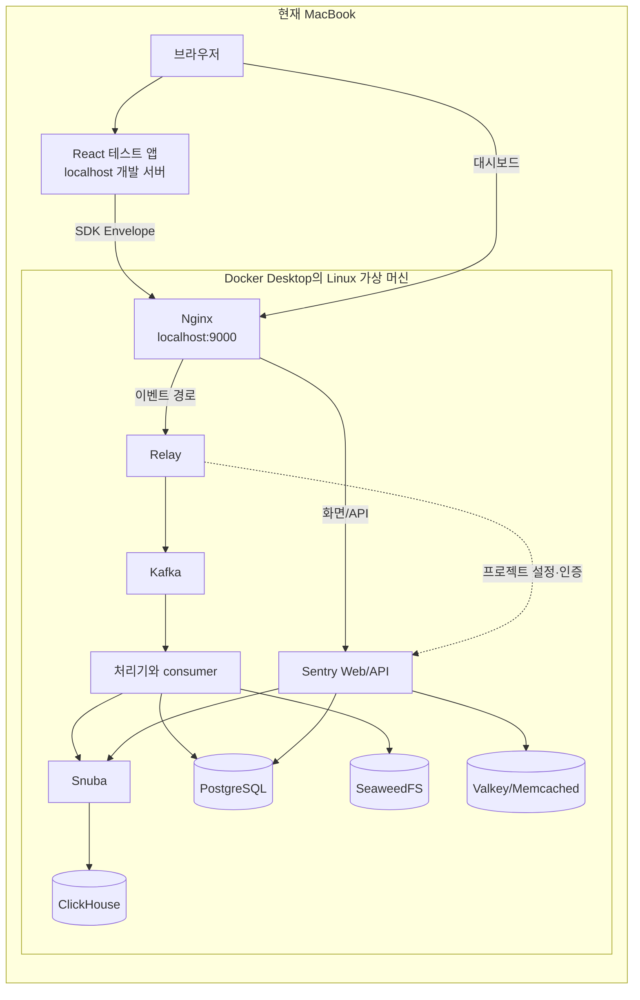
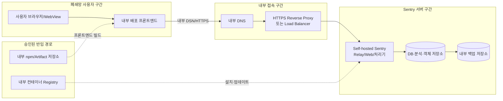
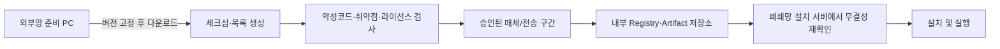

# Phase 1: 로컬 및 폐쇄망 아키텍처

## 먼저 이해할 Docker 개념

### 이미지와 컨테이너

- **Docker 이미지(image)**: 프로그램과 실행에 필요한 파일을 묶은 **읽기 전용 설치 꾸러미**입니다. 앱 설치 파일이나 템플릿에 가깝습니다.
- **컨테이너(container)**: **이미지를 실행한 프로세**스입니다. 같은 이미지로 여러 컨테이너를 만들 수 있습니다.
- **볼륨(volume)**: 컨테이너를 다시 만들어도 유지해야 하는 **데이터 저장 공간**입니다. Sentry 이벤트와 데이터베이스 파일이 여기에 남습니다.
- **네트워크(network)**: 컨테이너끼리 이름으로 통신할 수 있게 만든 내부 연결망입니다.
- **Docker Compose**: 이미지, 컨테이너, 볼륨, 네트워크의 관계를 YAML 파일 하나에 정의하고 함께 시작·중지하는 도구입니다.

컨테이너를 삭제하는 것과 볼륨을 삭제하는 것은 다릅니다. 
컨테이너는 실행 프로그램을 다시 만드는 일이지만, 
데이터 볼륨 삭제는 이벤트와 설정 데이터 손실로 이어질 수 있습니다. 
따라서 이후 단계에서도 `down`과 `down -v`를 엄격히 구분합니다.

## 왜 Sentry는 컨테이너 하나로 끝나지 않는가

Sentry는 단순히 HTTP 요청을 받아 파일 하나에 기록하는 앱이 아닙니다. 
갑자기 많은 이벤트가 들어와도 접수를 계속하고, 오류 원문·검색 색인·사용자 설정을 각 특성에 맞게 저장하며, 
백그라운드에서 그룹화와 통계를 계산해야 합니다.

하나의 프로그램에 모든 역할을 넣으면 어느 한 기능이 느려질 때 전체가 함께 멈추고, 
저장 방식도 각 데이터의 성격에 맞게 최적화하기 어렵습니다. Self-hosted는 역할을 여러 서비스로 나눕니다.

## 26.8.0 주요 구성요소
아래는 수십 개의 실제 컨테이너를 이해하기 쉬운 역할 단위로 묶은 표입니다. 서비스와 소비자의 정확한 개수는 Phase 2에서 고정한 Compose 설정으로 출력해 기록합니다.

| 역할 | 주요 구성요소 | 쉬운 설명 |
| --- | --- | --- |
| 입구 | Nginx | 브라우저 요청을 웹 화면과 이벤트 접수 경로로 나눕니다. |
| 이벤트 접수 | Relay | SDK 이벤트를 받아 검사·필터링·정규화하고 뒤쪽 처리 계층으로 전달합니다. |
| 웹/API | Sentry Web | 로그인, 프로젝트 설정, Issue 화면과 API를 제공합니다. |
| 비동기 작업 | Sentry consumer, taskworker, taskbroker 등 | 접수 후 시간이 걸리는 처리와 이벤트 종류별 작업을 수행합니다. |
| 대기열 | Kafka | 이벤트가 몰릴 때 잠시 보관하고 소비자에게 전달합니다. |
| 검색·분석 API | Snuba와 여러 consumer | ClickHouse에 데이터를 쓰고 Sentry 검색 요청을 해석합니다. |
| 분석 저장소 | ClickHouse | 대량 이벤트·Span을 빠르게 검색하고 집계합니다. |
| 관계형 저장소 | PostgreSQL + PgBouncer | 사용자, 조직, 프로젝트, 설정 같은 구조화된 메타데이터를 저장하고 DB 연결을 관리합니다. |
| 빠른 임시 상태 | Valkey, Memcached | 캐시, 버퍼, 속도 제한처럼 빠르게 읽고 쓰는 값을 담당합니다. Compose의 서비스 이름은 호환성을 위해 `redis`일 수 있습니다. |
| 원문/객체 저장 | SeaweedFS | 압축된 원본 이벤트 등 파일 성격의 데이터를 S3 호환 방식으로 저장합니다. |
| Stack trace 보조 | Symbolicator | Source map과 디버그 파일을 이용해 사람이 읽을 수 있는 코드 위치를 계산합니다. |
| 성능 처리 | Vroom 및 성능 관련 consumer | 프로파일과 성능 데이터 처리를 보조합니다. |
| 기타 선택 기능 | SMTP, uptime checker, Replay/로그 관련 처리기 등 | 이메일, 가동 확인, 기능별 데이터를 담당합니다. 외부 연동은 별도 네트워크가 필요할 수 있습니다. |

컨테이너가 여러 개인 것이 여러 대의 서버가 있다는 뜻은 아닙니다. 이 PoC에서는 모두 Docker Desktop의 한 Linux 가상 머신 안에서 돌아가는 **단일 노드(single node)** 구성입니다.

## 로컬 PoC 구조

### 네트워크 경계

- Mac 브라우저에서 보이는 주소는 `localhost:9000` 하나입니다.
- Nginx 뒤의 Relay, Kafka, PostgreSQL 같은 포트는 호스트에 공개하지 않고 Compose 내부 네트워크에서만 통신하는 것이 기본입니다.
- 테스트 앱이 다른 개발 포트에서 열리므로 브라우저의 CORS, 허용 도메인, DSN 주소를 확인해야 합니다.
- Wi-Fi를 꺼도 `localhost`와 Docker 내부 네트워크는 원칙적으로 계속 통신할 수 있습니다. 실제 동작은 Phase 8에서 확인합니다.

## 실제 회사 폐쇄망 구조

### 로컬 PoC와 회사 환경의 차이

| 항목 | 현재 PoC | 실제 회사 환경 |
| --- | --- | --- |
| 호스트 | 개인 Mac + Docker Desktop | 보통 전용 Linux 서버 또는 승인된 플랫폼 |
| 주소 | `localhost:9000` | 내부 DNS 이름, 예: `sentry.intra.example` |
| HTTPS | 학습 단계에서는 HTTP 가능 | 사용자·인증정보 보호를 위해 일반적으로 HTTPS 필요 |
| 인증서 | 없음 | 사내 CA 인증서와 신뢰 저장소 배포 필요 |
| 사용자 범위 | 한 명 | 팀·조직·역할 기반 접근 제어 필요 |
| 데이터 | 가짜 PoC 이벤트 | 업무 시스템 데이터이므로 보안·보존 정책 필요 |
| 백업 | 실험 단계 | 정기 백업과 복구 훈련 필요 |
| 가용성 | 노트북이 꺼지면 중단 | 장애 감시, 재시작, 용량 계획 필요 |
| 이미지 공급 | 인터넷에서 직접 다운로드 가능 | 외부 반입 심사와 내부 Registry 필요 |
| 확장 | 단일 노드 | 트래픽에 따라 별도 저장소·클러스터 검토 |

이 PoC가 확인할 수 있는 것은 SDK 통신, 이벤트 처리, 내부 저장, 화면 조회, 필터링, 외부망 차단 시 핵심 기능입니다. 회사의 고가용성, 다중 서버 장애 복구, 실제 보안 장비 정책까지 재현하지는 않습니다.

## 폐쇄망 반입 과정

폐쇄망 설치는 인터넷이 없는 서버에서 `git clone`이나 `docker pull`을 시도하는 방식이 아닙니다. 외부망에서 필요한 산출물을 모아 검사하고 내부 저장소로 옮기는 공급 절차가 먼저 필요합니다.

### 외부망에서 준비해야 할 범주

1. **Self-hosted 소스**  
   `getsentry/self-hosted`의 승인된 릴리스 태그와 커밋 SHA를 기록합니다.
2. **컨테이너 이미지**  
   Compose가 참조하는 모든 이미지와 플랫폼별 digest를 기록합니다. 태그는 바뀔 수 있으므로 가능하면 digest까지 고정합니다.
3. **설치 중 빌드 의존성**  
   Dockerfile이나 설치 스크립트가 인터넷에서 `pip`, `apt`, GitHub 파일을 추가로 받는지 확인합니다. 단순 이미지 목록만 옮겨서는 충분하지 않을 수 있습니다.
4. **프론트엔드 패키지**  
   React, Vite, Sentry SDK와 잠금 파일에 고정된 npm 패키지가 내부 Registry에서 제공되어야 합니다.
5. **Source map 도구**  
   `sentry-cli` 또는 빌드 플러그인의 실행 파일과 의존성을 내부에 준비합니다.
6. **인증서와 설정 템플릿**  
   사내 CA, 내부 DNS, 프록시, 보존 기간, 메일 설정을 환경별로 준비합니다. 실제 비밀값은 소스 묶음과 분리합니다.

### 반입 목록에 반드시 기록할 값

- 파일 또는 이미지 이름
- 버전과 CPU 아키텍처(`linux/amd64` 또는 `linux/arm64`)
- 원본 다운로드 위치
- SHA-256 체크섬 또는 이미지 digest
- 라이선스
- 취약점 검사 일시와 결과
- 내부 저장 위치
- 반입 승인자와 일자

Phase 2에서는 설치 전에 Compose를 파싱해 이 목록의 초안을 자동 생성합니다. Phase 8에서는 실제 이미지 아카이브 생성이 필요한지 먼저 용량을 보여 준 뒤 승인받습니다.

## 설치 시 의존성과 실행 시 의존성

| 시점 | 외부 의존 가능 항목 | 폐쇄망 대응 |
| --- | --- | --- |
| 소스 준비 | GitHub 릴리스 | 승인된 소스 아카이브 반입 |
| 이미지 준비 | GHCR, Docker Hub, GitLab Registry 등 | 내부 Registry로 복제하거나 이미지 아카이브 반입 |
| 이미지 빌드 | `pip`, `apt`, GitHub 다운로드 | 의존 파일 사전 캐시 또는 수정된 내부 빌드 경로 |
| 테스트 앱 설치 | npm Registry | 내부 npm Registry와 lockfile 사용 |
| SDK 로딩 | npm 번들 또는 Sentry CDN | 앱 번들에 포함하거나 Self-hosted SDK asset 사용 |
| Source map 업로드 | Sentry API | 내부 Sentry URL로 업로드 |
| 일반 이벤트 수집 | DSN 주소 | 내부 DNS/HTTPS의 Sentry 주소 사용 |
| 알림·연동 | SMTP, Slack, GitHub 등 | 내부 SMTP만 허용하거나 기능 비활성화 |
| 선택 기능 | GeoIP, 공개 API, AI 관련 호출 등 | 데이터 파일 사전 반입 또는 기능 비활성화 |

Self-hosted 26.8.0 설정에는 외부 호출이 없는 환경을 알리는 `SENTRY_AIR_GAP` 옵션이 있습니다. 이 값을 켠다고 네트워크 방화벽이 만들어지는 것은 아닙니다. Sentry가 외부 호출이 필요한 기능을 피하도록 하는 애플리케이션 설정이며, 실제 차단은 호스트·방화벽·Docker 네트워크 정책에서 별도로 보장해야 합니다.

## 데이터가 저장되는 위치를 역할별로 보기

정확한 테이블과 이벤트 유형별 경로는 복잡하지만, 운영 관점에서는 다음처럼 이해할 수 있습니다.

| 데이터 성격 | 대표 저장소 | 잃었을 때 영향 |
| --- | --- | --- |
| 조직, 사용자, 프로젝트, 설정 | PostgreSQL | 로그인과 프로젝트 구성이 손실될 수 있음 |
| 검색·집계할 이벤트와 Span | ClickHouse | Issue 분석과 대시보드 조회 데이터 손실 |
| 원본 이벤트/객체 | SeaweedFS | 상세 원문이나 연결된 객체 손실 가능 |
| 처리 대기 중 메시지 | Kafka | 아직 저장되지 않은 이벤트 유실 가능 |
| 캐시·임시 상태 | Valkey/Memcached | 일시적 성능 저하나 처리 오류; 일부 상태 영향 |

따라서 “Docker 볼륨 폴더 하나를 복사하면 백업 완료”라고 가정하지 않습니다. 데이터베이스별 일관된 백업과 복구 순서는 Phase 9에서 다룹니다.

## 보안 경계와 기본 원칙

1. 외부 또는 사용자 구간에 공개할 것은 Nginx/HTTPS 입구뿐입니다.
2. PostgreSQL, Kafka, ClickHouse, Valkey 포트를 사용자 네트워크에 직접 공개하지 않습니다.
3. SDK에서 보내기 전 민감정보를 제거하고 Relay/Sentry 서버에서 다시 필터링합니다.
4. 관리자 화면은 일반 서비스 사용자보다 더 제한된 내부 접근 정책을 적용합니다.
5. 실제 DSN, 관리자 비밀번호, 시스템 secret key, SMTP 자격증명은 Git에 넣지 않습니다.
6. 이미지와 패키지는 버전·digest·체크섬을 기록해 반입 후 변조 여부를 확인합니다.
7. `SENTRY_AIR_GAP=True`와 실제 네트워크 차단을 함께 검증합니다.

## Phase 2 전에 결정하거나 승인할 사항

- Docker Desktop을 설치해도 되는지
- Homebrew로 최신 Bash를 추가 설치해도 되는지
- Feature-complete 프로필과 Docker 자원 6 CPU/16GB 사용
- 약 20~40GB의 초기 이미지·볼륨 공간 사용
- 공식 Self-hosted `26.8.0` 태그 고정
- 테스트 앱은 별도 의견이 없으면 React + TypeScript + Vite + pnpm 사용

Phase 2에서는 위 항목을 다시 명령별로 설명하고, 대용량 다운로드를 시작하기 전에 명시적으로 확인받습니다.

## 공식 근거

- [Sentry Self-Hosted 공식 문서](https://develop.sentry.dev/self-hosted/)
- [Self-hosted 26.8.0 Docker Compose](https://github.com/getsentry/self-hosted/blob/26.8.0/docker-compose.yml)
- [Self-hosted 26.8.0 Nginx 라우팅](https://github.com/getsentry/self-hosted/blob/26.8.0/nginx.conf)
- [Self-hosted 26.8.0 Sentry 설정](https://github.com/getsentry/self-hosted/blob/26.8.0/sentry/sentry.conf.example.py)
- [Relay 공식 문서](https://develop.sentry.dev/relay/)
- [Snuba 공식 저장소](https://github.com/getsentry/snuba)
