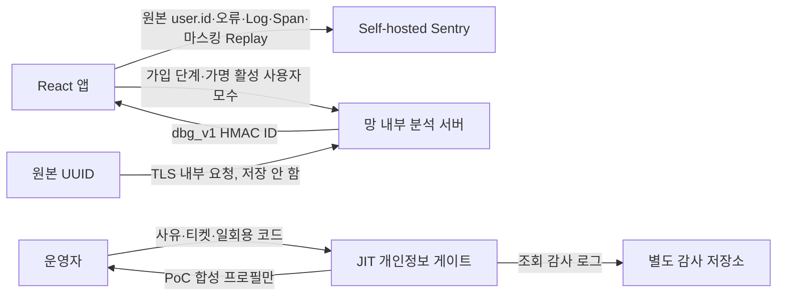

# 사내 프론트엔드 디버깅 허브 구현 설계

## 목표와 현재 상태

이 PoC는 Self-hosted Sentry 26.8.0을 오류·Logs·Replay·Trace·Web Vitals의 진단 허브로 사용하고, 정확한 업무 모수와 개인정보 조회는 망 내부 보조 서비스가 담당하게 구현했다. SaaS 결제나 외부 API 호출은 필요하지 않는다.

| 번호 | 기능 | 현재 판정 | 구현 위치 |
| ---: | --- | --- | --- |
| 1 | 한국어 UI | 핵심 운영 문구 오프라인 번역 구현 | `browser-extension/` |
| 2 | Session Replay | 로컬 기본 ON, 전체 마스킹·민감 영역 차단 | `test-app/src/sentry/replay.ts` |
| 3 | 가입 퍼널·이탈률 | 정확한 가입 시도 모수 집계 구현 | `signup-funnel/`, `internal-observability/` |
| 4 | 실시간 오류·로그 | Sentry Logs + Issue 동시 생성 구현 | `sentry/logging.ts` |
| 5 | 서비스별 오류 | 전용 프로젝트 3개 + `service` Tag 구현 | `services/`, `configure-service-projects.sh` |
| 6 | 특정 사용자 행동 | HMAC 가명 ID와 검색 링크 구현 | `identity/`, `identity-core.mjs` |
| 7 | 개인정보 ON/OFF | Sentry 밖 JIT 합성 조회 게이트 구현 | `privacy/`, `privacy-gate.mjs` |
| 8 | 일·주·월 오류 | 24h/7d/30d 저장 대시보드 구현 | Dashboard 4~6 |
| 9 | 사용자 대비 오류·이탈률 | 활성 사용자 모수 기반 순위 구현 | `analytics/`, `usage-core.mjs` |
| 10 | Web Vitals·Performance Score | Dashboard 3 전체/페이지별 score 구현 | `phase6-dashboards.json` |

테스트 앱은 `react-router-dom`의 `BrowserRouter`로 기능별 URL을 분리한다. `/`와 알 수 없는 경로는 SDK 초기화 전에 `/collection`으로 정규화하고, React Router 전용 Sentry tracing integration이 pageload와 navigation transaction을 실제 route path로 기록한다.

## 데이터 경계



Sentry에는 검색용 원본 `user.id`와 코드 진단에 필요한 최소 신호만 둔다. 가입 전환율의 분모, 활성 사용자 수와 나머지 고객 정보는 Sentry의 책임이 아니다.

## 1. 한국어 UI

Self-hosted Sentry 26.8.0에는 완전한 한국어 locale이 없다. Sentry 소스를 포크하면 업그레이드 비용이 커지므로, 이 PoC는 로컬 Sentry 두 origin에서만 실행되는 Manifest V3 확장을 사용한다.

- 정확히 일치하는 고정 메뉴·버튼 문구만 번역
- Event title, 검색식, stack, code, 사용자 입력은 번역하지 않음
- PoC가 정의한 Tag·Context는 내부 검색 키와 저장값을 유지하고 화면 표시만 번역
- 네트워크·저장소·클립보드 권한 없음
- 사전 확장은 `browser-extension/dictionary.js`만 수정

## 2. Session Replay

`test-app/src/sentry/client.ts`가 로컬 환경에서 Replay integration을 등록한다. `replay.ts`는 다음 정책을 코드로 고정한다.

- `maskAllText: true`
- `maskAllInputs: true`
- `blockAllMedia: true`
- `[data-sentry-block]`, `[data-private]`, `.sentry-block` 영역 전체 차단
- network detail allowlist 비움, request/response body 수집 금지
- 로컬 PoC 일반 세션 표본율 0, 오류 세션 표본율 1.0; production은 `VITE_SENTRY_REPLAY_ENABLED=true` 명시 전 OFF

Replay는 오류 이벤트 Relay scrubber와 저장 형식이 다르다. 운영 적용 전에는 실제 운영과 닮은 합성 인증·CDD 화면으로 Replay 저장본을 별도 검사해야 한다. 마스킹 해제 selector는 이 PoC에 제공하지 않는다.

## 3. 가입 퍼널과 이탈률

업무 순서는 `terms → account → phone → cdd`로 고정했다. 각 단계는 `/signup-funnel/terms`, `/signup-funnel/account`, `/signup-funnel/phone`, `/signup-funnel/cdd` 고유 URL을 사용한다. 브라우저는 원본 사용자 ID 대신 `sessionStorage`에 보관한 무작위 `attempt_v1_*` 가입 시도 ID를 보내며, 망 내부 서버가 `page_view`, `advanced`, `abandoned`, `completed` 이벤트를 NDJSON으로 저장한다. 기존 `entered` 이벤트는 과거 데이터 호환을 위해 pageView로 계속 읽는다.

단계 `i`의 이탈률은 다음과 같다.

```text
유예시간이 지난 뒤에도 다음 단계 pageView 또는 완료가 없는 가입 시도 수
÷ 단계 i pageView 가입 시도 수 × 100
```

기본 유예시간은 30분이며 `FUNNEL_DROPOFF_GRACE_PERIOD_MS`로 조정한다. 유예시간 전에는 `판정 대기`, 이후에는 `확정 이탈`로 표시한다. 새로고침 pageView는 같은 시도·단계에서 중복 집계하지 않고 마지막 관측 시각만 갱신한다. 명시 이탈 버튼은 즉시 확정하는 보조 신호이며, 탭 종료 시점의 불안정한 unload 전송을 공식 기준으로 사용하지 않는다.

각 pageView와 전환은 동시에 Sentry `ui.funnel` span과 breadcrumb를 만들고 `page.path`를 남긴다. 정확한 수치는 내부 분석 서버에서 보고, 오류 원인은 Sentry의 trace·issue에서 본다.

## 4. 실시간 오류와 Logs

Sentry는 처리 큐를 거치므로 near-real-time이다. `logging.ts`는 자유문 대신 다음 고정 메시지를 보낸다.

- `frontend_action_completed`
- `frontend_api_slow`
- `frontend_payment_failed`

속성은 `service`, `page`, 정제된 오류 코드와 합성 여부만 허용한다. error 시나리오는 구조화 Log와 동일 `service/page`의 Issue를 함께 생성한다. HTTP ingest 성공만으로 완료 처리하지 않고 `Sentry.flush`와 최종 UI/API 저장을 확인한다.

## 5. 서비스별 오류

두 단계 경계를 사용한다.

1. 단일 SPA/PoC: `service:membership|remittance|payment` Tag로 Issues, Logs, Traces 필터
2. 독립 배포/운영: `frontend-membership`, `frontend-remittance`, `frontend-payment` 프로젝트와 DSN 분리

세 프로젝트는 API 스크립트로 생성됐고, 최종 보안 리뷰 후 네 프로젝트 모두 동일한 Relay selector 58개를 적용했다. 새 프로젝트를 추가할 때도 생성 직후 Phase 7 설정과 server probe를 실행한다.

## 6. 특정 사용자 행동 추적

원본 고객 ID는 `Sentry.setUser({id})`로 scope에 직접 연결하며 SDK `beforeSend`와 Relay가 그대로 보존한다. 이메일·username·IP 등 다른 사용자 필드는 계속 제거한다. 같은 원본에서 내부 서버가 만든 `dbg_v1_*` HMAC ID는 내부 분석과 JIT 게이트에만 사용한다.

원본 `user.id`로 Issues, Logs, Replays, Traces에서 동일 사용자의 흐름을 검색할 수 있다. 이 정책은 Sentry 자체가 개인정보 저장소가 된다는 뜻이므로 운영에서는 접근 권한, 보존 기간, 감사와 삭제 요청 절차를 별도로 관리한다.

## 7. 개인정보 ON/OFF

공용 인증번호로 Sentry 화면의 개인정보를 복원하는 기능은 구현하지 않았다. 대신 별도 JIT 게이트가 다음을 강제한다.

- 대상 `dbg_v1_*` ID
- 10~200자의 조회 사유
- 승인 티켓
- 5분 만료·최대 5회 시도의 일회용 코드
- 대상 사용자에 고정된 10분 세션
- 즉시 폐기와 화면 언마운트/사용자 전환 시 자동 폐기
- token·인증번호 없는 별도 감사 로그

현재 adapter는 합성 프로필만 반환한다. 운영 연결에는 사내 SSO/MFA, 승인 워크플로, 실제 고객 API adapter, 감사 로그의 변경불가 저장소가 추가로 필요하다. 조회 결과를 Sentry Tag·Context·Log·Replay로 복사하지 않는다.

## 8. 일간·주간·월간 오류

Dashboard 4, 5, 6은 각각 24시간, 7일, 30일로 저장됐다. 각 대시보드는 동일하게 오류 수, 영향 사용자 수, 시계열, 상위 오류를 제공한다. 달력 월 보고는 Dashboard 6에서 absolute start/end를 해당 월 경계로 바꾼다.

## 9. 오류 순위와 사용자 모수 대비 비율

Sentry 이벤트 수만으로 정상 사용자 분모를 알 수 없으므로 망 내부 서버가 서비스별 활성 사용자 집합을 보관한다.

```text
오류 영향 사용자율 = 해당 Issue 고유 영향 사용자 ÷ 같은 서비스 활성 사용자 × 100
```

분모가 없으면 0%가 아니라 `모수 없음`으로 표시한다. 반복 이벤트 건수와 영향 사용자율을 모두 제공하므로 “한 명에게 1,000번 난 오류”와 “1,000명에게 한 번씩 난 오류”를 구분할 수 있다.

## 10. Web Vitals와 Performance Score

`browserTracingIntegration`이 pageload와 Web Vitals span을 수집한다. Dashboard 3에는 다음이 저장됐다.

- P75 LCP, FCP, INP, CLS, TTFB
- `performance_score(measurements.score.total)` 전체 점수
- transaction별 page table의 Score와 모든 Web Vital
- API rate/duration, HTTP failure ratio, slow API, pageload duration

Dashboard는 운영 요약용이고, 표본·release·browser별 원인 분석은 Insights > Frontend > Web Vitals에서 한다.

## 공통 taxonomy

| 목적 | 필드 |
| --- | --- |
| 배포 경계 | project, environment, release |
| 서비스·화면 | service, page |
| 업무 오류 | error_code, process_step, channel, partner |
| 사용자 상관관계 | user.id=`<원본 고객 ID>`, signup.attempt_id=`attempt_v1_*` |
| 퍼널 | funnel.name, funnel.step, funnel.event |

고객 이름, 전화번호, 이메일, 계좌, CI, 인증번호, token, HTTP body는 taxonomy에 넣지 않는다.

## 완료 증적

- React 18개 테스트 파일, 48개 테스트 통과
- Node 정책·집계·Relay·Dashboard·번역 테스트 15개 통과
- TypeScript, ESLint, production build 통과
- 서비스 프로젝트 ID 3·4·5 생성, 재실행 중복 없음
- Dashboard ID 1~6 저장, Dashboard 3 score 수식 API 재조회 성공
- 네 프론트 프로젝트에서 `$user.id`를 제외한 Relay 개인정보 selector 적용
- 서버 단독 probe에서 원본 `user.id` 보존과 나머지 17개 민감값 제거
- identity probe에서 내부용 `dbg_v1_*` ID도 보존

Node 22.2에서도 빌드는 성공했지만 Vite 8 권장 범위는 Node 20.19+ 또는 22.12+이므로 운영 개발 환경은 해당 버전 이상으로 맞춘다.

## 관련 문서

- [화면 주소와 사용법](11-frontend-debugging-guide.md)
- [다른 프론트엔드 적용 Quick Guide](12-frontend-observability-quick-guide.md)
- [개인정보·Relay 정책](07-security.md)
- [Dashboard 정의와 검증](06-dashboards.md)
