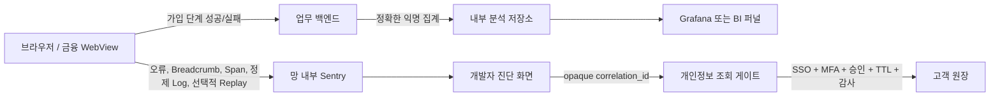

# 사내 프론트엔드 디버깅 종합 대시보드 설계

## 목적과 전제

이 문서는 Self-hosted Sentry 26.8.0을 외부 SaaS 구독 없이 망 내부에서 운영한다는 전제로, 프론트엔드 개발자가 오류·행동 맥락·성능을 한곳에서 진단할 수 있는 체계를 설계한다.

Sentry는 기술 장애를 코드, 릴리스, Trace, Breadcrumb, Replay와 연결하는 **진단 허브**로 사용한다. 가입 전환율의 회계 수준 집계, 고객 원장 조회, Sentry 자체 인프라 관제까지 모두 Sentry에 넣는 구조는 피한다. SaaS 구독료는 없지만 서버, 저장소, 백업, 업그레이드, 보안 운영 비용은 남으며 운영 전에는 배포 버전의 라이선스도 법무 검토가 필요하다.

현재 PoC 기준값은 다음과 같다.

- 조직: `sentry`
- 프론트엔드 프로젝트: `frontend-poc`, project ID `2`
- Sentry: `http://127.0.0.1:9000`
- 테스트 앱: `http://127.0.0.1:5173`
- React SDK: `@sentry/react` 10.72.0
- Sentry 서버: Self-hosted 26.8.0 feature-complete 구성
- 개인정보: 클라이언트 정제와 Relay 정제를 모두 사용하며 서버는 `$user.id`도 제거
- Replay: SDK integration 미등록, 정상 세션과 오류 세션 표본율 모두 0

## 권장 경계



| 저장 위치 | 넣을 데이터 | 넣지 않을 데이터 |
| --- | --- | --- |
| Sentry | 오류 코드, 정규화 페이지, 서비스, 릴리스, 환경, Span, 비식별 흐름 상태 | 이름, 전화번호, 계좌번호, 인증번호, 요청·응답 원문, 고객 UUID 원문 |
| 내부 분석 저장소 | 화면 진입·완료의 정확한 집계, 승인된 가명 식별자, 퍼널 기준 시각 | 디버깅용 stack trace 전체 |
| 개인정보 조회 게이트 | 원장과 correlation ID의 승인된 최소 매핑 | Sentry 이벤트 복제본, 공용 해제 코드 |

## 전체 판정

| 번호 | 요구 기능 | 판정 | 주 구현 위치 |
| ---: | --- | --- | --- |
| 1 | Sentry 한글 UI | 완전한 내장 지원 없음 | 브라우저 번역 + 한국어 운영 문서 권장 |
| 2 | Session Replay | 설치본에 있음, 현재 정책상 OFF | SDK + Replay 권한 + 별도 개인정보 검증 |
| 3 | 가입 퍼널·화면별 이탈률 | 진단용 근사 가능, 정확 집계는 별도 분석계 권장 | 업무 백엔드/분석계 + Sentry 상호 링크 |
| 4 | 실시간 오류·커스텀 로그 | 가능, 처리 지연이 있는 near-real-time | Issues + Explore Logs |
| 5 | 서비스별 오류 | 가능, 현재 Tag 대시보드도 있음 | Project 분리 + `service` Tag |
| 6 | 특정 사용자 행동 | 조건부 가능 | 가명 ID 승인 또는 세션/가입 시도 ID |
| 7 | 인증번호로 개인정보 ON/OFF | 제안 방식은 금지 | Sentry 밖 JIT 개인정보 조회 게이트 |
| 8 | 일·주·월 오류 | 가능 | 기간 선택 + 저장 Dashboard |
| 9 | 오류 순위·사용자 모수 대비 비율 | 식별 정책과 정상 사용자 모수가 필요 | Sentry + 내부 분석계 |
| 10 | 페이지별 FCP/LCP·Performance Score | 가능, Web Vitals는 이미 수집 확인 | Insights Web Vitals + Dashboard 3 |

## 1. 한국어 UI

설치된 26.8.0의 계정 설정에는 언어 선택 UI가 있지만 한국어(`ko`)가 선택 목록에 없다. 현재 프론트엔드 번들 목록은 영어, 일본어, 중국어, 프랑스어, 독일어 등 14개 언어뿐이다. 로그인 화면 일부가 한국어로 보이더라도 전체 제품 번역을 의미하지 않는다.

권장 순서는 다음과 같다.

1. Chrome의 사이트 번역을 개인별로 사용한다. 검색식, Tag 이름, 필드명은 영문 원문을 유지한다.
2. [기능 사용 안내서](11-frontend-debugging-guide.md)에 실제 로컬 URL, 영문 메뉴명, 한국어 설명을 유지한다.
3. 사내 포털에 자주 쓰는 Sentry 링크와 한국어 용어집을 제공한다.
4. Sentry 프론트엔드를 fork해 `ko` 번역 카탈로그를 유지하는 방법은 가능하지만, 매 버전 신규 문자열 번역과 upstream 병합 비용이 크므로 전담 유지보수 조직 없이는 채택하지 않는다.

언어 설정 화면은 `http://127.0.0.1:9000/settings/account/details/`이다.

## 2. Session Replay

설치본에는 Replay 화면, API, `snuba-replays-consumer`가 있고 로컬 Replays API도 HTTP 200을 반환했다. 따라서 서버 기능은 존재한다. 현재 앱이 Replay를 보내지 않는 이유는 기능 부재가 아니라 [Phase 7 개인정보 정책](07-security.md)이다.

도입 조건은 다음과 같다.

- 기본값은 `maskAllText: true`, `maskAllInputs: true`, `blockAllMedia: true`로 둔다.
- CDD, 휴대폰·계좌 인증, 키패드, 신분증, 웹뷰 브리지 영역은 요소 전체를 block한다.
- 네트워크 request/response body와 추가 header 캡처는 허용하지 않는다.
- 정상 세션은 우선 0%, 오류 발생 세션만 5~10%의 작은 표본으로 시작한다.
- Replay 열람자를 별도 최소 인원으로 제한하고 조회 로그를 정기 감사한다.
- 현재 조직 API의 `hasGranularReplayPermissions` 값은 `false`다. 이 기능을 실제로 켤 수 있는지 설치본에서 추가 검증하기 전에는 Project/조직 membership과 망 접근 제어로 Replay 접근자를 제한한다.
- 현재 Phase 7의 서버 probe는 **오류 이벤트**만 검증했다. rrweb 기반 Replay recording payload가 같은 방식으로 정제된다고 가정하면 안 되며, Replay 전용 합성 개인정보 저장 probe를 새로 통과해야 한다.
- Replay의 navigation URL에도 query/fragment가 들어갈 수 있으므로 URL에 개인정보를 싣지 않고 recording 저장본에서 URL 정제 여부를 따로 검사한다.
- 저장량, 브라우저 CPU, 전송량, 재생 성공률을 실제 WebView 기기에서 측정한다.

권장 초기 설정 예시는 다음과 같다. 이는 승인 전 적용 코드가 아니라 보안 검토용 기준안이다.

```ts
Sentry.init({
  // 기존 DSN, release, trace 설정 유지
  integrations: [
    Sentry.browserTracingIntegration(),
    Sentry.replayIntegration({
      maskAllText: true,
      maskAllInputs: true,
      blockAllMedia: true,
      block: ["[data-sentry-block]", ".authentication-screen", ".cdd-screen"],
      networkDetailAllowUrls: [],
      networkCaptureBodies: false,
    }),
  ],
  replaysSessionSampleRate: 0,
  replaysOnErrorSampleRate: 0.05,
});
```

조회 화면은 `http://127.0.0.1:9000/organizations/sentry/explore/replays/?project=2`이다. 구형 `/organizations/sentry/replays/` 주소도 설치본에서 새 Explore 경로로 연결된다.

## 3. 가입 퍼널과 화면별 이탈률

가입 흐름은 다음과 같이 고정된 기계 이름을 사용한다.

| 순서 | `flow_step` | 표시 이름 |
| ---: | --- | --- |
| 1 | `terms` | 약관 동의 |
| 2 | `account-verification` | 계좌 인증 |
| 3 | `phone-verification` | 휴대폰 인증 |
| 4 | `cdd` | CDD |
| 5 | `complete` | 가입 완료 |

각 단계에서 최소 다음 상태를 발생시킨다.

- `entered`: 화면이 실제로 표시됨
- `completed`: 서버가 해당 단계 완료를 확정함
- `failed`: 정규화된 오류 코드와 함께 실패함
- `abandoned`: 서버가 정의한 timeout을 지나 다음 단계로 가지 않음

권장 이벤트 계약은 다음과 같다.

```text
event_name: signup_flow_transition
flow_name: member-signup
flow_version: v1
flow_step: terms | account-verification | phone-verification | cdd | complete
transition: entered | completed | failed | abandoned
page: signup-terms | signup-account | signup-phone | signup-cdd | signup-complete
service: membership
channel: <승인된 저카디널리티 값>
outcome: success | failure | cancel | timeout
error_code: <고정 코드 또는 없음>
release, environment: SDK 공통 필드
journey_id: 가입 시도용 난수 ID; Tag로 집계하지 않고 상세 상관관계에만 사용
```

### 지표 정의

단순 이벤트 기준 근사치는 다음과 같다.

```text
단계 완료율 = completed(step) / entered(step) × 100
다음 단계 전환율 = entered(next_step) / completed(step) × 100
단계 이탈률 = 100 - 다음 단계 전환율
```

같은 사람이 새로고침·재시도하면 이벤트 기준 수치가 왜곡된다. 사용자 기준 지표는 다음처럼 정의해야 한다.

```text
사용자 기준 단계 이탈률
= (고유 entered(step) - 고유 entered(next_step)) / 고유 entered(step) × 100
```

이 계산에는 순서를 보존하는 안정적인 가명 식별자와 정상 사용자 모수가 필요하다. 현재 Relay는 `$user.id`를 제거하므로 Sentry만으로 고유 사용자 퍼널을 계산할 수 없다. 정확한 공식 지표는 업무 백엔드가 성공 상태를 확정한 뒤 내부 분석 저장소에 기록하고, Sentry에는 동일 `journey_id` 또는 trace ID를 넣어 오류 진단으로 이동하게 한다.

Sentry만 사용하는 축소안은 Explore Logs 또는 custom Span에서 `flow_step`, `transition`별 건수를 집계하는 것이다. 이 값은 **운영 진단용 근사치**로 표시하고 경영·준법 보고의 원장 수치로 사용하지 않는다.

## 4. 실시간 오류와 커스텀 로그

Sentry의 Issues와 Logs는 수집 파이프라인을 거치므로 strict real-time이 아니라 수 초 이상의 지연이 생길 수 있는 near-real-time이다.

- 예외: `captureException`, 처리되지 않은 오류 자동 수집 → Issues
- 업무 경고: `captureMessage` → Issues
- 연속적인 구조화 로그: `Sentry.logger.info|warn|error` → Explore Logs
- 오류 이전의 짧은 맥락: Breadcrumb → 개별 Issue 상세

Logs는 모든 `console.log`를 복제하지 않는다. 허용된 고정 메시지와 저카디널리티 속성만 전송하고 자유 입력, API body, 전체 상태 객체는 거부한다.

```ts
Sentry.logger.info("signup.flow.transition", {
  flow_step: "phone-verification",
  transition: "failed",
  service: "membership",
  error_code: "PHONE_VERIFICATION_TIMEOUT",
});
```

화면 주소:

- Issues: `http://127.0.0.1:9000/organizations/sentry/issues/?project=2`
- Logs: `http://127.0.0.1:9000/organizations/sentry/explore/logs/?project=2`

## 5. 서비스별 오류

독립 배포·독립 담당 조직·별도 알림 기준이 있는 프론트엔드는 Sentry Project를 서비스별로 분리한다. 하나의 shell/WebView 안에서 함께 배포되는 모듈은 Project 하나를 유지하고 `service` Tag로 구분할 수 있다.

| 조건 | 권장 방식 |
| --- | --- |
| DSN, 릴리스, 담당 팀, 접근권한이 다름 | Project 분리 |
| 같은 bundle·같은 배포이고 업무 메뉴만 다름 | Project 하나 + `service` Tag |
| 운영/검증 환경 구분 | Project 복제보다 `environment` 사용 |

공통 Tag는 `service`, `page`, `channel`, `flow_step`, `error_code`로 제한한다. 고객 ID나 request ID처럼 값의 종류가 계속 증가하는 데이터는 Tag로 만들지 않는다.

현재 서비스별 차트는 `http://127.0.0.1:9000/organizations/sentry/dashboard/2/`의 **Errors by Service** 위젯에 구현돼 있다.

## 6. 특정 사용자 행동 추적

기술적으로 `Sentry.setUser({id})`, Breadcrumb, Replay, Trace를 조합하면 특정 사용자의 흐름을 찾을 수 있다. 하지만 UUID도 다른 정보와 결합하면 개인을 식별할 수 있으므로 익명 데이터로 간주하지 않는다.

현재 기본 정책에서는 원본 UUID도, `anon-*`도 서버에서 제거한다. 선택지는 두 가지다.

### 기본 모드: 식별자 미저장

- 오류 한 건의 Breadcrumb와 trace ID로만 흐름을 본다.
- 가입 시도마다 새 난수 `journey_id`를 발급하고 짧은 TTL 동안만 상관관계에 사용한다.
- 사용자 검색과 고유 영향 사용자 수는 제공하지 않는다.

### 보안 승인 모드: 서버 발급 가명 ID

- 브라우저가 원본 UUID를 hash하지 않는다.
- 인증 백엔드가 비밀키 HMAC 또는 무작위 매핑으로 `debug_subject_id`를 발급한다.
- 원본과의 매핑은 Sentry 밖에 저장하고 접근·보관 기간을 제한한다.
- Relay의 `$user.id` 제거 규칙을 무조건 해제하지 말고 승인된 형식만 보존하는 정책과 원본 대입 공격 probe를 추가한다.
- Sentry에 저장된 가명 ID도 개인정보에 준해 관리한다.

## 7. 개인정보 ON/OFF

“특정 인증번호를 입력하면 Sentry에 저장된 개인정보가 보이는” 기능은 구현하지 않는다.

1. 개인정보를 먼저 저장한 뒤 UI에서 숨기기만 하면 관리자 API, export, 알림, 백업에는 원문이 남을 수 있다.
2. 공유 인증번호는 계정 권한과 무관한 우회 통로가 된다.
3. Relay에서 제거된 데이터는 나중에 다시 표시할 수 없다. 이것이 의도한 보안 특성이다.

대신 Sentry는 항상 마스킹 상태를 유지하고 별도 **개인정보 조회 게이트**를 둔다.

현재 조직 API에서 `enhancedPrivacy`는 `false`다. 알림과 부가 화면에서 PII·소스 노출을 더 제한하려면 이 옵션의 영향을 합성 이벤트로 검증한 뒤 활성화를 검토한다. 이 옵션도 저장 전 Relay 정제를 대신하거나 제거된 개인정보를 복원하는 ON/OFF 스위치는 아니다.

```text
Sentry의 correlation_id 선택
→ 사내 SSO 재인증
→ 사용자별 MFA 또는 OTP step-up
→ 사유·티켓·대상 입력
→ 필요 시 2인 승인
→ 10~15분 JIT 권한
→ 원장 최소 필드만 별도 화면에 표시
→ 조회자·사유·대상·시간·결과 감사 기록
→ TTL 만료와 세션 폐기
```

OTP를 사용하더라도 사용자별 step-up 인증 요소일 뿐, 하나의 공용 “해제 코드”가 되어서는 안 된다. 조회한 원문을 Sentry Tag, Context, Replay, 로그에 다시 복사하는 기능도 금지한다.

## 8. 일간·주간·월간 오류

현재 Dashboard 1에서 우측 상단 기간 선택기를 사용해 24시간, 7일, 30일을 선택하면 된다. “월간”의 정의가 중요하다.

- 최근 30일: rolling 30 days
- 달력 월: 매월 1일 00:00부터 말일 23:59:59까지 명시적 start/end

오류 이벤트 수와 고유 Issue 수를 함께 둔다. 한 Issue가 반복 폭증하는 상황과 서로 다른 신규 오류가 많이 생기는 상황을 분리하기 위해서다. 보관 기간이 90일이면 그보다 오래된 월간 비교는 불가능하므로 운영 용량 정책과 함께 결정한다.

화면은 `http://127.0.0.1:9000/organizations/sentry/dashboard/1/`이다.

## 9. 오류 순위와 사용자 모수 대비 비율

서로 다른 지표를 명확히 구분한다.

```text
사용자당 오류 건수 = 오류 이벤트 수 / 활성 사용자 수
오류 영향 사용자율 = 오류를 1회 이상 겪은 고유 사용자 수 / 전체 활성 사용자 수 × 100
```

사용자당 오류 건수는 100%를 넘을 수 있다. 요청한 “사용자수 대비 비율”에는 0~100%인 **오류 영향 사용자율**을 기본 KPI로 사용하고, 반복성 판단을 위해 사용자당 오류 건수를 보조 지표로 둔다.

Sentry Issues는 이벤트 빈도와 영향 사용자 수로 오류를 정렬할 수 있다. 그러나 전체 활성 사용자 분모는 정상 세션도 수집해야 생긴다. Release Health의 session/user 집계나 내부 분석계의 DAU를 분모로 사용해야 하며, 현재 `$user.id` 제거 정책에서는 고유 사용자 집계가 0이다.

정확한 권장 계산은 내부 분석계에서 한다.

```text
오류 영향 사용자율(service, period)
= unique(debug_subject_id with error) / unique(active debug_subject_id) × 100
```

Sentry 장기·표본 데이터의 `count_unique`는 근사치가 될 수 있으므로 금융·준법 공식 수치에는 사용하지 않는다. 오류 순위 화면은 Issues, 서비스별 순위는 Dashboard 2를 사용한다.

## 10. 페이지별 Web Vitals와 Performance Score

현재 SDK의 `browserTracingIntegration()`이 활성화돼 있고 실제 Span에서 LCP, FCP, INP, TTFB가 확인됐다. 설치본의 Web Vitals 화면은 페이지별 p75와 `performance_score(measurements.score.*)`를 지원한다.

- 기본 화면: `http://127.0.0.1:9000/organizations/sentry/insights/frontend/pageloads/?project=2`
- PoC 차트: `http://127.0.0.1:9000/organizations/sentry/dashboard/3/`

페이지 이름은 `/users/123?token=...` 같은 실제 URL이 아니라 `signup-phone`, `transfer-review` 같은 정규화 이름으로 보낸다. p75를 기본으로 보고 표본 수를 항상 함께 표시한다. 표본이 적으면 점수 변화의 신뢰도가 낮다.

권장 위젯은 다음과 같다.

- 페이지별 total Performance Score
- 페이지별 p75 LCP/FCP/INP/CLS/TTFB
- 표본 수 `count()`
- 릴리스 전후 점수 비교
- 느린 페이지 Top 10
- 브라우저/OS별 breakdown

SPA route 전환에서는 모든 pageload Web Vital이 새로 발생하지 않을 수 있다. 화면 전환 시간은 route transaction 또는 `ui.route.change` custom Span으로 별도 측정한다. 금융 WebView는 실제 기기와 내장 브라우저 버전별로 지원 여부를 검증한다.

## 공통 분류 체계

### 검색·집계용 Tag

| Tag | 예시 | 규칙 |
| --- | --- | --- |
| `service` | `membership` | 승인 목록 |
| `page` | `signup-phone` | route parameter 제거 |
| `channel` | `hana-ez` | 승인 목록 |
| `flow_name` | `member-signup` | 승인 목록 |
| `flow_step` | `phone-verification` | 승인 목록 |
| `transition` | `failed` | 승인 목록 |
| `error_code` | `PHONE_VERIFICATION_TIMEOUT` | 고정 코드 |

### 상세 분석용 Context/Span attribute

- retry count
- 정제된 API endpoint alias
- safe business state
- feature flag 이름과 값
- `journey_id`, trace ID 같은 고카디널리티 상관관계 값

Context는 이벤트 상세에는 보이지만 검색·집계되지 않는다. 값 종류가 무한히 늘어나는 필드를 무리하게 Tag로 만들지 않는다.

## 단계별 도입안

### Gate 0: 지금 바로 사용

- Issues, Source map, Breadcrumb, Release, 기존 Dashboard 1~3
- `service`, `page`, `error_code`, `flow_step` 분류 표준화
- 일·주·30일 기간별 운영 루틴

### Gate 1: 구조화 Logs와 퍼널 진단

- `enableLogs`와 `beforeSendLog` 정제 정책 추가
- 가입 흐름 이벤트 계약과 테스트 추가
- Sentry 근사치와 업무 백엔드 공식 지표를 명확히 라벨링

### Gate 2: Replay 제한 시범

- 오류 표본 5% 이하
- 인증·CDD 화면 전체 block
- Replay 전용 클라이언트/서버 저장 probe 통과
- 열람자 최소화, 저장량과 기기 성능 측정

### Gate 3: 사용자 기준 지표

- 개인정보 영향평가와 보안 승인
- 백엔드 발급 가명 ID와 외부 매핑 저장소
- Relay allow 규칙과 원본 UUID 차단 probe
- 내부 분석계에서 정확한 분모/퍼널 계산

### Gate 4: 개인정보 조회 게이트

- 사내 IAM, MFA, JIT, 승인, 감사, TTL 구현
- Sentry에는 원문 미저장 원칙 유지
- 운영자 오남용 시나리오와 감사 대응 훈련

## 완료 기준

- 새 서비스가 같은 Tag와 release 규칙을 사용한다.
- 오류 한 건에서 정제된 Breadcrumb, 관련 Trace, release, source-mapped stack을 찾을 수 있다.
- 서비스·페이지·오류 코드별 오류가 Dashboard에 나타난다.
- Web Vitals 화면에서 표본 수와 p75를 페이지별로 볼 수 있다.
- 퍼널 수치가 “Sentry 근사”인지 “업무계 공식”인지 화면에 구분된다.
- Replay를 켠 경우 인증·CDD 합성 민감값이 녹화와 저장본 어디에도 없다.
- 어떤 계정도 공용 코드만으로 개인정보를 볼 수 없다.
- 보안 승인 전에는 원본 사용자 ID와 Replay가 계속 차단된다.

## 공식 참고 자료

- [Self-hosted Sentry](https://develop.sentry.dev/self-hosted/)
- [React Session Replay](https://docs.sentry.io/platforms/javascript/guides/react/session-replay/)
- [Session Replay privacy](https://docs.sentry.io/platforms/javascript/guides/react/session-replay/privacy/)
- [React Logs](https://docs.sentry.io/platforms/javascript/guides/react/logs/)
- [Issue Details](https://docs.sentry.io/product/issues/issue-details/)
- [Frontend Web Vitals](https://docs.sentry.io/product/insights/frontend/web-vitals/)
- [Explore timeseries API](https://docs.sentry.io/api/explore/query-explore-events-in-timeseries-format/)
- [Release Health session statistics API](https://docs.sentry.io/api/releases/retrieve-release-health-session-statistics/)
- [Organization privacy settings API](https://docs.sentry.io/api/organizations/update-an-organization/)
